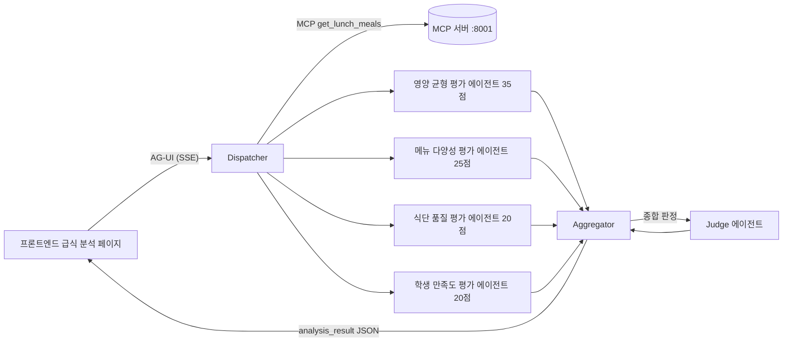

# 급식 배틀 멀티에이전트 앱 (`src/agents`)

Microsoft Agent Framework(MAF)의 **Concurrent(팬아웃-팬인) 오케스트레이션 패턴**으로 두 학교의 중식을 `EVALUATION_RUBRIC.md` 기준에 따라 비교 평가하는 멀티에이전트 서버입니다.

## 아키텍처: Concurrent 패턴



- **Dispatcher**: 프롬프트의 JSON 블록(학교 2곳·날짜)을 파싱하고 MCP 서버에서 두 학교의 중식 데이터를 조회한 뒤, 4개 평가 에이전트에 동일한 평가 요청을 **팬아웃**합니다.
- **평가 에이전트 4개**: 루브릭의 4개 영역(영양 균형 35 / 메뉴 다양성 25 / 식단 품질 20 / 학생 만족도 20)을 각각 담당하며 **동시에** 독립적으로 평가합니다. 영역별 세부 항목을 1~5점으로 채점한 JSON을 반환합니다.
- **Aggregator**: 4개 결과를 **팬인**해 학교별 100점 만점 점수로 환산하고(채점 불가 영역은 제외 후 가중치 재환산), Judge 에이전트에게 종합 판정을 요청한 뒤 최종 `analysis_result` JSON을 출력합니다.

`WorkflowBuilder.add_fan_out_edges` / `add_fan_in_edges`로 구성하며, 코드는 `app/workflow.py`에 있습니다.

### 왜 Concurrent 패턴인가

루브릭의 4개 평가 영역은 서로 의존성이 없는 독립 평가입니다. Concurrent 패턴은 ① 영역별 평가를 병렬 수행해 지연 시간을 최소화하고, ② 에이전트별 프롬프트를 영역에 특화해 평가 품질을 높이며, ③ 한 영역이 채점 불가여도 나머지 영역으로 점수를 재환산할 수 있어 루브릭의 "평가 불가 처리" 규칙과 자연스럽게 맞습니다. Sequential(불필요한 직렬화), Group Chat/Handoff(협상·위임이 필요 없는 과제), Magentic(과도한 오버헤드) 대비 이 과제에 최적입니다.

## LLM 연동: GitHub Copilot SDK

기본 백엔드는 **GitHub Copilot SDK**(`agent-framework-github-copilot`의 `GitHubCopilotAgent`)입니다. 로컬에 GitHub Copilot CLI가 설치·인증되어 있으면 별도 API 키 없이 동작합니다.

Copilot CLI를 쓸 수 없는 환경(Docker, CI)을 위해 **GitHub Models 폴백**(`AGENT_LLM_BACKEND=github-models`, `GITHUB_TOKEN` 필요)을 제공합니다. 선택은 `app/llm.py`의 `create_agent()`가 담당합니다.

| 환경 변수 | 설명 | 기본값 |
|---|---|---|
| `AGENT_LLM_BACKEND` | `copilot` 또는 `github-models` | `copilot` |
| `GITHUB_COPILOT_MODEL` | Copilot 백엔드 모델(비우면 기본) | (없음) |
| `GITHUB_TOKEN` | GitHub Models용 토큰 | (없음) |
| `GITHUB_MODELS_MODEL` | GitHub Models 모델 | `openai/gpt-4.1-mini` |
| `MCP_URL` | 급식 조회 MCP 엔드포인트 | `http://localhost:8001/mcp` |
| `AGENT_HOST` / `AGENT_PORT` | 서버 바인딩 | `0.0.0.0` / `8002` |

## 실행

```bash
cd src/agents
python -m app.server        # AG-UI 서버 (:8002, 엔드포인트 /agent)
python -m app.devui         # DevUI로 워크플로우 시각화·디버깅 (:8090)
```

MCP 서버(`src/mcp`, :8001)가 먼저 떠 있어야 실제 급식 데이터를 조회할 수 있습니다. 프론트엔드는 `/agent` 프록시(AG-UI 프로토콜, SSE)로 이 서버와 통신합니다.

## 테스트

```bash
cd src/agents
python -m pytest
```

가짜 LLM 클라이언트(`tests/helpers.py`)로 워크플로우 전체(팬아웃-팬인, 점수 환산, AG-UI SSE 엔드포인트)를 검증합니다.

## 계층 구조

| 파일 | 책임 |
|---|---|
| `app/config.py` | 환경 변수 기반 설정 |
| `app/rubric.py` | `EVALUATION_RUBRIC.md` 기반 평가 영역·에이전트 지시문 |
| `app/schemas.py` | 요청/결과 데이터 계약 |
| `app/request_parser.py` | 프롬프트 내 JSON 블록 파싱 |
| `app/meal_source.py` | MCP 클라이언트 (급식 데이터 조회) |
| `app/llm.py` | LLM 백엔드 선택 (Copilot SDK / GitHub Models) |
| `app/workflow.py` | Concurrent 워크플로우 (Dispatcher → 4 에이전트 → Aggregator → Judge) |
| `app/scoring.py` | 100점 환산·재환산·승자 판정 |
| `app/server.py` | FastAPI + AG-UI 엔드포인트 (`/agent`) |
| `app/devui.py` | DevUI 실행 진입점 |
